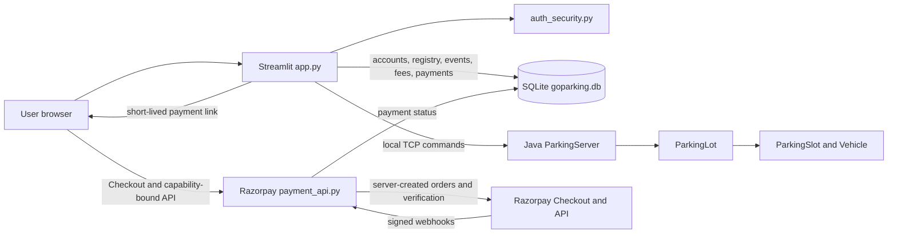
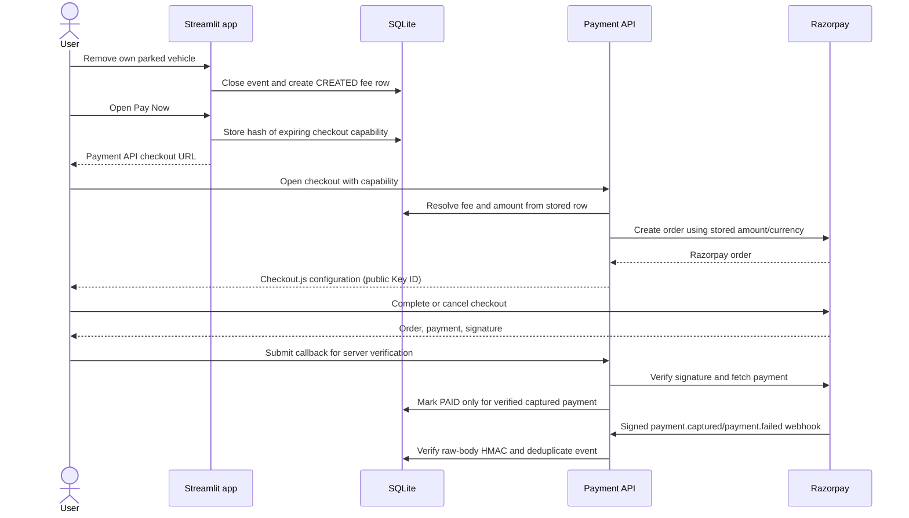
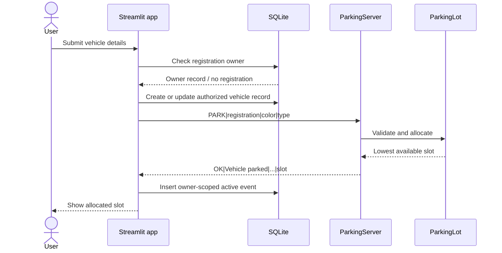
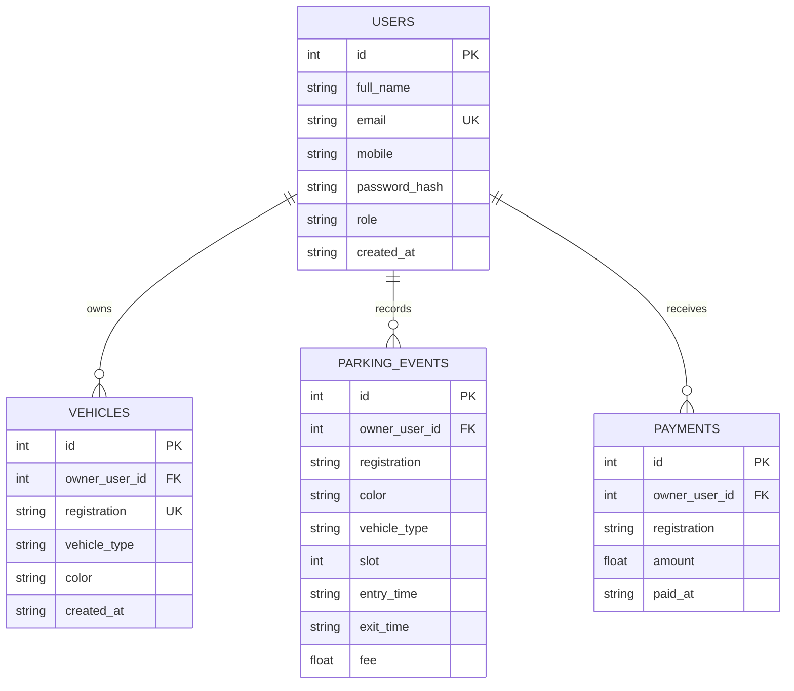
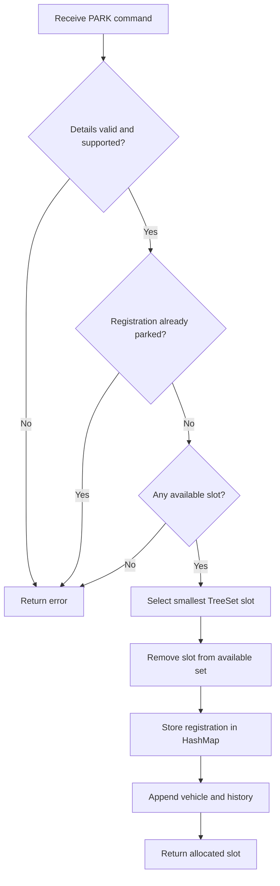

# GoParking Architecture and UML Diagrams

## Component architecture

The app database and Java in-memory allocation state are separate stores.
Restoration on startup is best effort; operations are not a distributed
transaction.

The payment API is a separate Python process and shares the SQLite database
with Streamlit. The browser receives only a short-lived capability for one
owner-scoped payment; the API secret and webhook verification stay server-side.

## Payment sequence

## Park vehicle sequence

## Account entity relationships

## Parking allocation activity

